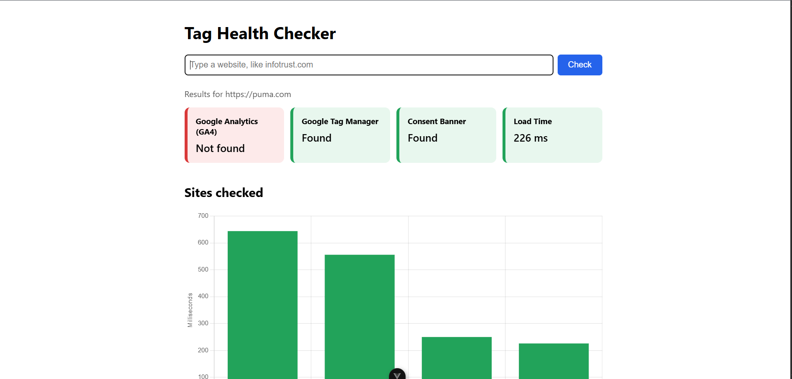
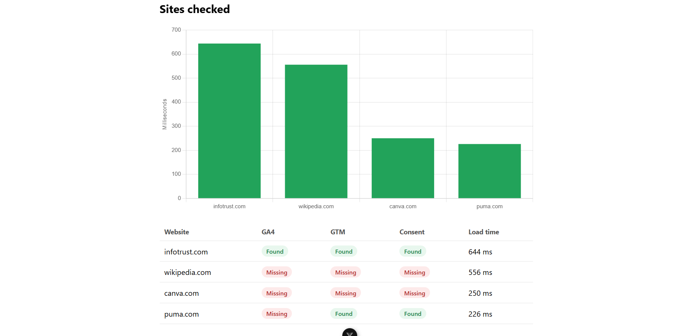

# Tag Health Checker

A small full-stack tool that checks whether a website has Google Analytics, Google Tag Manager, and a cookie consent tool installed, and how fast the page loads.





## Why I built it

I wanted a practical feel for how websites collect analytics data and handle user consent, and to learn TypeScript, Node.js, and Vue by building something real rather than only following tutorials.

## What it checks

- **Google Analytics 4 (GA4):** looks for Google's gtag script and GA4 measurement IDs
- **Google Tag Manager (GTM):** looks for the GTM script or container ID
- **Consent tool:** looks for common consent management platforms (OneTrust, Cookiebot, TrustArc, Osano, and others)
- **Load time:** measures how long the page takes to download

Results show as color-coded cards, plus a history table and a load-time chart for every site checked.

## Tech stack

- **Backend:** Node.js, Express, TypeScript
- **Frontend:** Vue 3, TypeScript, Vite, Chart.js
- **Testing:** Vitest

## How it works

1. You enter a website in the Vue frontend.
2. The frontend sends it to the Express backend.
3. The backend downloads the page's HTML, searches it for known tag and consent tool signatures, and times the request.
4. The results come back as JSON and are displayed on the dashboard.

## Running it locally

You'll need [Node.js](https://nodejs.org) installed.

**1. Start the backend**

```bash
cd server
npm install
npm run dev
```

Runs at http://localhost:3000

**2. Start the frontend** (in a second terminal)

```bash
cd client
npm install
npm run dev
```

Opens at http://localhost:5173

**3. Run the tests**

```bash
cd server
npm test
```


## Limitations

This tool only reads a page's original HTML. That means:

- Tags loaded later by JavaScript (for example, GA4 loaded through Tag Manager) can be missed.
- It can tell whether a consent tool **exists**, but not whether it actually **works**, meaning whether tracking stops after a visitor clicks "Reject."

## Next steps

- Use Playwright to load pages in a real browser, simulate accepting and rejecting consent, and record which tags actually fire
- Add Docker so the whole project runs with one command

## What I learned

- TypeScript fundamentals: types, interfaces, union types, and type narrowing
- Building a REST API with Express
- Building a reactive frontend with Vue's Composition API
- Connecting a frontend and backend, including handling CORS
- Writing unit tests with Vitest
- The difference between a consent banner being present and consent actually being respected